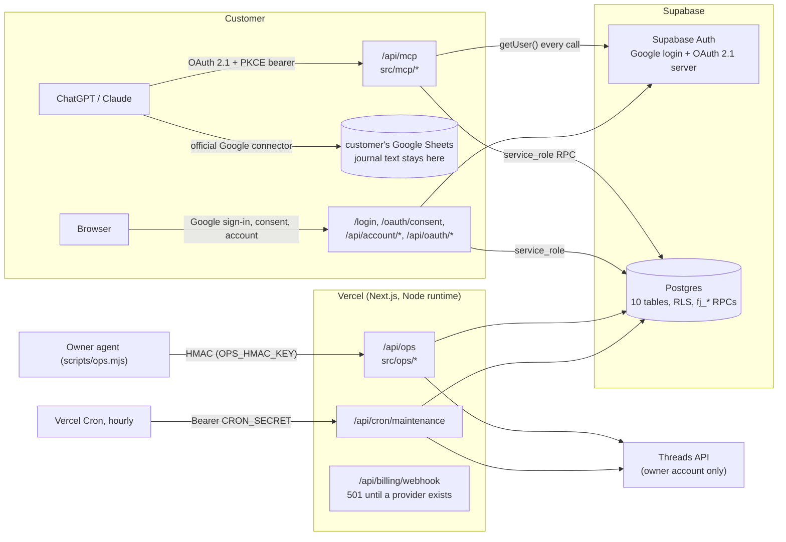

# Architecture

ルールの正本は [AGENTS.md](../AGENTS.md)。ここは「どこに何があり、リクエストがどう流れるか」の地図。DBの詳細は [DATABASE.md](DATABASE.md) と生成物 [generated/DB_CATALOG.md](generated/DB_CATALOG.md)。

## 全体像

顧客の手帳・相談・出生情報は自社サーバーに保存されない。自社MCPはGoogleに一切アクセスしない。

## レイヤーと依存方向

依存は上から下へだけ。`src/domain` は何にも依存しない（I/Oなし、node:cryptoのみ）。

| 層 | 場所 | 責務 |
|---|---|---|
| HTTP入口 | `app/**/route.ts`, `app/**/page.tsx`, `middleware.ts` | 認証方式の判定、入力の受取り、HTTPステータスへの変換だけ |
| MCPツール | `src/mcp/tools.ts`（一覧）, `schemas.ts`（入出力契約）, `readings.ts`, `account.ts`, `journal.ts`, `response.ts` | 7ツールの定義と処理。認証ゲート・計測・失敗コードは `tools.ts` で一度だけ適用 |
| 運営API | `src/ops/commands.ts`（一覧）, `posts.ts`, `insights.ts`, `runs.ts`, `report.ts`, `maintenance.ts` | 投稿の下書き→承認→公開、Insights収集、run履歴と費用、レポート、定期保守 |
| 顧客アカウント | `src/account.ts` | 任意計測の同意、エクスポート、アカウント削除 |
| 純粋ロジック | `src/domain/*` | 数秘術、タロット、journalテンプレート、OAuth claim検査、HMAC/参照リンク、Threads応答の正規化 |
| 外部連携 | `src/integrations/threads.ts` | Threads API（固定ホスト、POST再送なし） |
| 基盤 | `src/lib/env.ts`（設定・フラグ）, `secrets.ts`, `supabase/*`, `oauth.ts`（bearer検証）, `perf.ts`（計測）, `urls.ts` | |
| DB | `supabase/migrations/*.sql` | 料金・Trial・上限・冪等性・課金順序・保持期限の正本（原子的な判定はDBトランザクション内） |

`src/mcp` は `src/ops` と Threads を import しない（`check:static` が検査）。

## 顧客MCPツール（7個）

全ツール: OAuth bearer必須 → `verifyOAuthBearer`（未検証claimで明らかな不正を先に拒否 → `auth.getUser()` → claim照合）→ 検証済みuser idだけをハンドラへ。

| ツール | 処理 | 往復（Auth + DB） | 主なエラー |
|---|---|---|---|
| `get_account_profile` | 安定IDを返す。同意済みなら応答後に接続イベント | 1 + 0（計測ONでも応答経路は0、`after()`） | |
| `get_access_status` | `fj_access_status` | 1 + 1 | ACCESS_TEMPORARILY_UNAVAILABLE |
| `get_journal_schema` | 静的テンプレートと書込みルール | 1 + 0 | |
| `calculate_numerology` | 計算 → `fj_record_calculation` | 1 + 1 | INVALID_DATE, USAGE_LIMIT_REACHED, IDEMPOTENCY_CONFLICT, ACCOUNT_SUSPENDED |
| `draw_tarot` | HMAC抽選 → `fj_record_calculation` | 1 + 1 | FEATURE_NOT_INCLUDED, 上と同じ |
| `submit_reading_feedback` | `fj_submit_feedback`（計測OFFならDBなし） | 1 + 0/1 | OPTIONAL_ANALYTICS_DISABLED, FEEDBACK_NOT_ACCEPTED |
| `report_journal_action` | `fj_record_funnel`（同上） | 1 + 0/1 | OPTIONAL_ANALYTICS_DISABLED, REPORT_NOT_ACCEPTED |

期限切れ・他issuer・client_idなしのtokenは Auth 0回で401（RFC 9728 `resource_metadata` 付き）。実測は [PERFORMANCE.md](PERFORMANCE.md)。

## Webと運営の経路

| 経路 | 認証 | 処理 |
|---|---|---|
| `/login`, `/oauth/consent` | Supabaseセッションcookie | Googleログイン、接続同意（client名・callback host・未検証client警告）、設定・接続解除・エクスポート・削除の画面 |
| `/api/oauth/decision`, `/api/oauth/revoke`, `/api/account/*`, `/auth/signout` | 同一Origin POST + セッション | 同意/拒否、接続解除、`src/account.ts` |
| `/.well-known/oauth-protected-resource[/api/mcp]` | 公開 | RFC 9728 PRM（`resource` = `APP_ORIGIN/api/mcp`） |
| `/api/ops` | HMAC（±300秒、64KiB、query禁止） | `src/ops/commands.ts` のallowlist |
| `/api/cron/maintenance` | `Bearer CRON_SECRET` | 日次purge、24/72/168h snapshot（最大3件）、日次account snapshot。公開はしない |
| `/api/billing/webhook` | — | 常に501 |
| `/api/health` | 公開 | バージョンのみ |

## 冪等性の要点

- 計算: user + requestId/drawId + HMAC fingerprint。台帳1行 = 利用1回。同一入力の再試行はreplay（Trial終了後も）、別入力はconflict。
- 運営: `automation_runs(task, idempotency_key)` のlease。公開は1回だけclaimでき、不明なら `publish_unknown`。
- 課金: provider + event id、さらに economic key。subscription snapshotは `provider_updated_at` で順序付け。
- 収集: run id + 対象粒度で一意。run（90日）より snapshot（400日）が長く残るので run_id は外部キーにしない。
